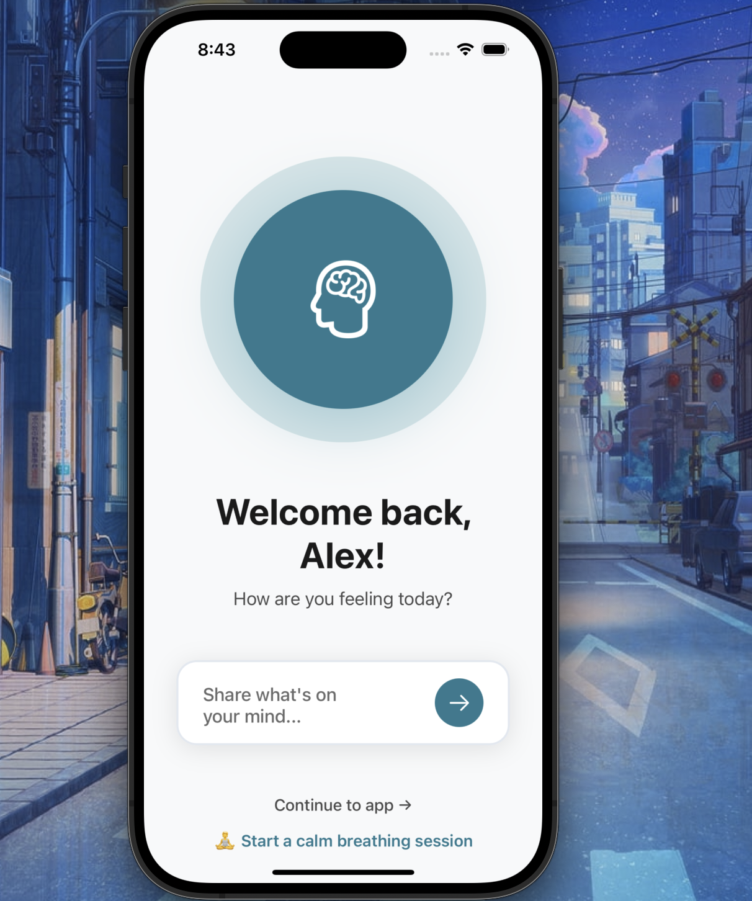
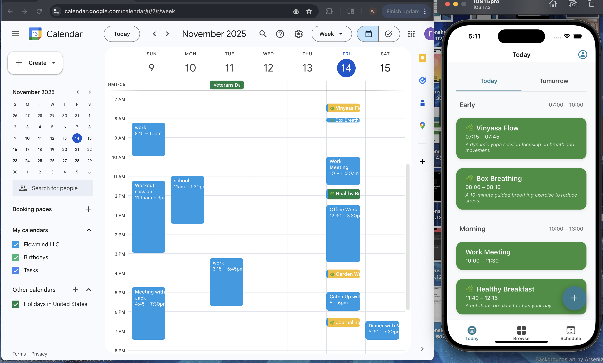
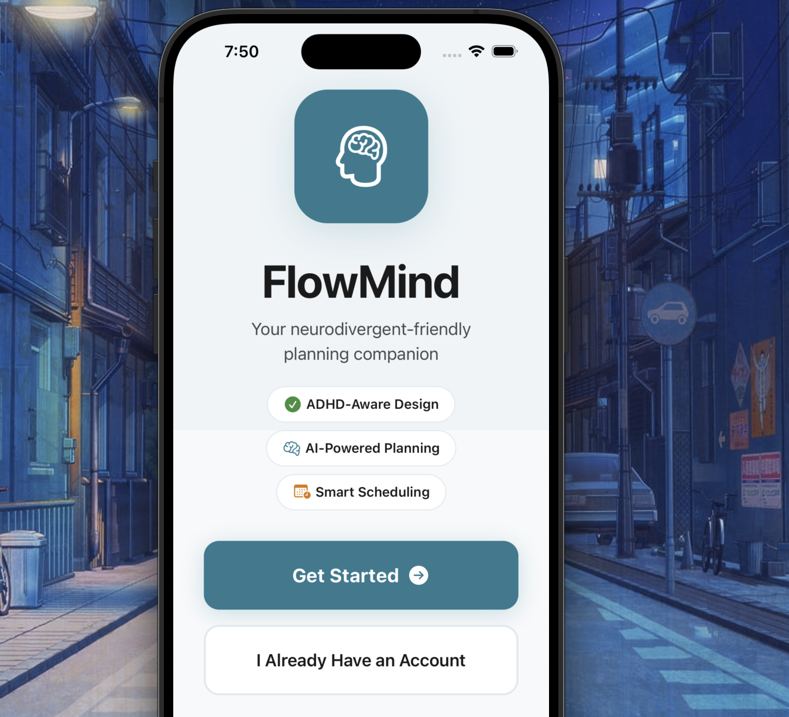
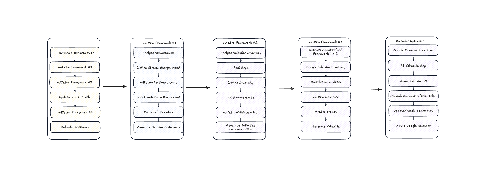

# FlowMind - AI-Powered Mental Health Planning App
### Built for SBU Hack25' - Optimizing daily life through mindful structure and AI assistance

> **Designed for ADHD, autistic, dyslexic, and neurodivergent users**  
> Lower cognitive load • Voice-first interface • Intelligent scheduling • Compassionate support

FlowMind is a therapeutic planning companion that uses **AI-driven conversation** and **schedule intelligence** to help neurodivergent users manage their day with less stress. Powered by IBM NeuralSeek's mAIstro for sentiment analysis and OpenAI Whisper for voice transcription.

## 🎬 Video Demo

[](https://www.youtube.com/watch?v=4L5e3T1ukhQ)

**Watch the full demo**: [https://www.youtube.com/watch?v=4L5e3T1ukhQ](https://www.youtube.com/watch?v=4L5e3T1ukhQ)

---

## 🧠 Key Features

### Voice-First Conversational AI
- **🎙️ Voice Mood Check-ins**: Speak naturally about how you're feeling
- **🤖 AI Sentiment Analysis**: mAIstro analyzes mood with schedule correlation
- **🔊 TTS Responses**: ElevenLabs generates empathetic voice responses
- **📊 Mood Tracking**: Continuous mood patterns with schedule impact analysis
- **💬 Multi-turn Conversations**: Natural dialogue that remembers context

<p align="center">
  
</p>

### Intelligent Calendar Integration
- **📅 Google Calendar Sync**: Automatic schedule analysis
- **⏰ Schedule Intensity Detection**: High/medium/low workload calculation
- **🎯 Agentic Activity Generation**: AI fills gaps with workouts, meals, breathing breaks
- **🔄 Real-time Updates**: Webhook-based calendar monitoring
- **📈 Pattern Discovery**: AI learns optimal activity timing from your habits



### Neurodivergent-First Design
- **Calm UI Mode**: Reduced motion, high contrast (WCAG AAA), larger touch targets
- **Micro-Steps**: Every task broken into 3-5 concrete actions
- **Choice Architecture**: Max 2 options to reduce decision fatigue
- **Predictable Timing**: 10-3-1 minute nudges (gentle haptics)
- **Energy-Aware**: Activities only during your peak energy windows
- **No Guilt Design**: Skip buttons always visible, no streak shaming

<p align="center">
  
</p>

### Privacy & Data Security
- **Local-First**: Profile stored securely on device (expo-secure-store)
- **Supabase Backend**: Optional cloud sync with row-level security
- **OAuth 2.0**: Secure Google Calendar integration via Auth0
- **Encrypted Storage**: All sensitive data encrypted at rest



---

## 🏗️ Architecture

```
┌──────────────────────────────────────────────────────────┐
│                  iOS App (Expo/React Native)             │
│  ┌──────────┐  ┌──────────┐  ┌──────────┐  ┌──────────┐│
│  │  Today   │  │ Explore  │  │  Mood    │  │ Profile  ││
│  │  View    │  │   Tab    │  │ Check-in │  │ Settings ││
│  └──────────┘  └──────────┘  └──────────┘  └──────────┘│
│        ↓             ↓             ↓             ↓       │
│  ┌────────────────────────────────────────────────────┐ │
│  │  Voice Recording (expo-av) + Secure Storage       │ │
│  └────────────────────────────────────────────────────┘ │
└────────────────────────┬─────────────────────────────────┘
                         │ HTTPS/REST API
                         ▼
┌──────────────────────────────────────────────────────────┐
│              Node.js Backend (Express)                   │
│  ┌─────────────────┐  ┌─────────────────┐              │
│  │  API Routes     │  │  Services       │              │
│  │  • Users        │  │  • Conversational│             │
│  │  • Conversation │  │    Agent        │             │
│  │  • Calendar     │  │  • Calendar Sync│             │
│  │  • Mood         │  │  • Agentic      │             │
│  │  • Orchestration│  │  • Health       │             │
│  └─────────────────┘  └─────────────────┘              │
└────┬────────┬──────────┬─────────┬─────────────────────┘
     │        │          │         │
     ▼        ▼          ▼         ▼
┌─────────┐ ┌──────────┐ ┌─────────┐ ┌─────────────────┐
│Supabase │ │NeuralSeek│ │ OpenAI  │ │  ElevenLabs     │
│PostgreSQL│ │ mAIstro  │ │ Whisper │ │  TTS (Rachel)  │
│         │ │          │ │         │ │                 │
│ • Users │ │ • Sentiment│ │ • Voice │ │ • Voice Response│
│ • Moods │ │   Analysis│ │  Transcr│ │ • Calm tone    │
│ • Plans │ │ • Schedule│ │  iption │ │ • Empathetic   │
│ • Events│ │  Correlation│ │       │ │                 │
└─────────┘ └──────────┘ └─────────┘ └─────────────────┘
                                      
┌──────────────────────────────────┐
│    Google Calendar API           │
│  • OAuth 2.0 via Auth0          │
│  • Webhook subscriptions        │
│  • FreeBusy queries             │
│  • Event creation               │
└──────────────────────────────────┘
```

---

## 📱 Tech Stack

### Client (iOS - Expo/React Native)
- **Expo SDK 52** - Cross-platform mobile framework
- **TypeScript** - Type safety and developer experience
- **expo-av** - Audio recording for voice input
- **expo-haptics** - Sensory-friendly tactile feedback
- **expo-secure-store** - Encrypted local profile storage
- **@react-native-google-signin/google-signin** - Google OAuth
- **@supabase/supabase-js** - Cloud database client

### Server (Node.js/Express)
- **Express 4.x** - REST API framework
- **ES Modules** - Modern JavaScript syntax
- **Supabase Client** - PostgreSQL database access
- **node-fetch** - HTTP client for external APIs
- **Webhook System** - Google Calendar real-time updates

### External APIs & Services
- **IBM NeuralSeek mAIstro** - Agentic Framework Orchestration to extract AI sentiment analysis & conversational responses
- **OpenAI Whisper** - Voice-to-text transcription ($0.006/min)
- **ElevenLabs TTS** - Text-to-speech with Rachel voice (10k chars/month free)
- **Google Calendar API** - Schedule synchronization & event management
- **Supabase** - PostgreSQL database with real-time subscriptions
- **Auth0** - OAuth 2.0 authentication provider

### Database (Supabase/PostgreSQL)

**Core Tables:**
```sql
-- User management (email-based, Auth0 optional)
users (id UUID, email, name, auth0_sub, created_at)

-- Neurodivergent preferences & personality
user_profiles (user_id, neuro_preferences JSONB, personality_traits JSONB)

-- Voice mood check-ins with AI analysis
mood_check_ins (id, user_id, transcription, mood_score, ai_analysis JSONB)

-- Weekly schedule context
weekly_schedules (id, user_id, avg_daily_density, daily_breakdown JSONB)

-- AI-discovered patterns
mood_patterns (id, user_id, pattern_type, confidence_score, recommendations JSONB)

-- Conversation history for mAIstro context
conversations (id, user_id, role, message, mood_score, created_at)

-- Calendar sync events
calendar_sync_events (id, user_id, event_id, start_time, end_time, title)

-- AI-generated activities
agentic_activities (id, user_id, activity_type, title, start_time, duration_sec)
```

---

---

## 🚀 Getting Started

### Prerequisites
- **Node.js** 18+ and npm
- **Xcode** 14+ (for iOS development)
- **Expo CLI** (`npm install -g expo-cli`)
- **Accounts Required**:
  - [Supabase](https://supabase.com) (free tier: 500MB database, 1GB file storage)
  - [IBM NeuralSeek](https://neuralseek.com) (free trial available)
  - [OpenAI](https://platform.openai.com) ($5 free credit for Whisper API)
  - [ElevenLabs](https://elevenlabs.io) (10,000 characters/month free)
  - [Google Cloud Console](https://console.cloud.google.com) (Calendar API)
  - [Auth0](https://auth0.com) (free: 7k users, social login)

### 1. Clone & Install

```bash
git clone https://github.com/willofcode/flowmind.git
cd flowmind

# Install server dependencies
cd server
npm install

# Install client dependencies
cd ../client
npm install
```

### 2. Set Up Database

1. Create a [Supabase](https://supabase.com) project
2. Run the complete schema:
   ```bash
   # Copy SQL from supabase-schema.sql in root directory
   # Paste into Supabase SQL Editor and execute
   ```
3. Copy your project URL and anon key

### 3. Google Calendar Setup

Follow detailed guides in:
- `Guide/GOOGLE_CALENDAR_INTEGRATION_COMPLETE.md` - Complete OAuth setup
- `Guide/QUICK_TEST_GUIDE.md` - Testing checklist

**Quick Steps:**
1. Enable Calendar API in Google Cloud Console
2. Create OAuth 2.0 credentials (iOS + Web app)
3. Add authorized redirect URIs:
   - `https://dev-YOUR_TENANT.us.auth0.com/login/callback`
   - `com.googleusercontent.apps.YOUR_CLIENT_ID:/oauth2redirect/google`
4. Download `GoogleService-Info.plist` → `client/` folder
5. Set up ngrok tunnel for webhooks:
   ```bash
   ngrok http 3001
   # Copy HTTPS URL to GOOGLE_CALENDAR_WEBHOOK_URL
   ```

### 4. Voice Transcription Setup

See `Guide/VOICE_TRANSCRIPTION_ELEVENLABS_SETUP.md` for complete guide.

**Quick OpenAI Whisper Setup:**
1. Get API key from [OpenAI Platform](https://platform.openai.com/api-keys)
2. Add to `client/.env`:
   ```bash
   EXPO_PUBLIC_OPENAI_API_KEY=sk-your_key_here
   ```
3. **Cost:** $0.006 per minute ($5 credit = ~833 minutes)

**ElevenLabs TTS Setup:**
1. Get API key from [ElevenLabs](https://elevenlabs.io)
2. Add to `server/.env`:
   ```bash
   ELEVENLABS_API_KEY=sk_your_key_here
   ```
3. **Free tier:** 10,000 characters/month (~20-30 conversations)

### 5. Run the App

**Terminal 1 - Backend Server:**
```bash
cd server
npm start

# Should see:
# ✅ Database connected
# ✅ NeuralSeek connected
# 🎉 FlowMind API Server running on http://localhost:3001
```

**Terminal 2 - iOS Client:**
```bash
cd client
npx expo prebuild  # First time only - generates native iOS folder
npm run ios        # Opens Xcode simulator
```

### 6. Test Voice Features

1. **Mood Check-in with Voice:**
   - Open app → Explore tab
   - Tap conversation bubble icon
   - Tap microphone 🎤
   - Speak: "I'm feeling great today!"
   - Watch AI analyze sentiment + play TTS response

2. **Calendar Sync:**
   - Sign in with Google
   - App automatically fetches schedule
   - AI generates activities based on free time

3. **Breathing Sessions:**
   - Navigate to calm session screen
   - Choose 5/10/15 minute session
   - Listen to guided TTS breathing exercise

---

## 📖 Usage Guide

### First Launch: Create Your Neuro Profile

1. Open app → **Profile** tab
2. Answer questions about:
   - **Activities**: Preferred workouts (walks, yoga, weights...)
   - **Energy Windows**: When you have focus/energy (e.g., 10am-12pm, 4pm-6pm)
   - **Focus Limits**: Maximum focus block length (e.g., 25 minutes)
   - **Sensory Preferences**: 
     - Reduced motion animations
     - Haptics-only feedback (no sounds)
     - High contrast mode
     - Silent mode schedule
   - **Diet**: Style (Mediterranean, vegan...) & restrictions
   - **Sleep**: Usual bedtime & wake time
   - **Buffer Policy**: Pre/post activity padding (default: 10 min)

### Voice Mood Check-in (Main Feature)

1. **Explore Tab** → Tap floating conversation icon
2. **Record Voice Message:**
   - Tap microphone 🎤
   - Speak naturally: "I'm feeling overwhelmed with today's schedule"
   - Tap stop when done
3. **AI Analysis:**
   - OpenAI Whisper transcribes your voice
   - mAIstro analyzes sentiment + correlates with calendar
   - Mood score calculated (1-10)
   - Schedule impact assessed (high/medium/low intensity)
4. **Empathetic Response:**
   - AI generates supportive response
   - ElevenLabs TTS plays voice response (Rachel voice)
   - Recommendations displayed
5. **Continue Conversation:**
   - Multi-turn dialogue supported
   - AI remembers context from previous turns
   - Can type text or use voice

### Today View - What to Do Now

1. **Today** tab shows your next scheduled activity
2. See **3 micro-steps** with concrete actions:
   - ✅ "Fill water bottle"
   - ✅ "Put on sneakers"
   - ✅ "Go outside for 5-minute walk"
3. Tap **"Start"** when ready
4. Get **10-3-1 minute nudges** (gentle haptic feedback)
5. Complete micro-steps one by one
6. Tap **"Complete"** when done
7. Options:
   - **Swap Alternative**: Quick A/B alternative activity
   - **Skip**: No guilt, always available

### Calendar-Based Activity Generation

1. **Google Calendar Sync:**
   - App fetches your schedule every 10 seconds
   - Calculates schedule intensity:
     - **High (>70% busy)**: Insert 5-10 min breathing breaks only
     - **Medium (40-70%)**: Add movement snacks + meals
     - **Low (<40%)**: Full workouts + meal prep + optional activities
2. **Automatic Gap Filling:**
   - AI detects free time windows
   - Generates appropriate activities
   - Respects energy windows from profile
   - Applies buffer rules (10 min before/after)
3. **Activity Types:**
   - 🏃 Workouts (15-60 min)
   - 🍽️ Meals (30-45 min)
   - 🧘 Breathing sessions (5-15 min)
   - 🚶 Movement snacks (10 min)

### Breathing Sessions with TTS

1. Navigate to **Calm Session** screen
2. Choose duration: 5 / 10 / 15 minutes
3. AI generates personalized breathing script
4. ElevenLabs creates soothing audio guidance
5. Play session:
   - Calm voice (Rachel)
   - Gentle pacing
   - Grounding techniques
   - Can pause/resume
6. Sessions cached for reuse (saves API costs)

---

## 🧩 Project Structure

```
flowmind/
├── client/                          # Expo/React Native iOS app
│   ├── app/                         # App screens (Expo Router)
│   │   ├── (tabs)/                  # Tab navigation
│   │   │   ├── index.tsx            # Today View - next activity
│   │   │   ├── explore.tsx          # Browse + conversation mode
│   │   │   ├── mood-insights.tsx    # Mood tracking history
│   │   │   └── profile.tsx          # Settings & preferences
│   │   ├── welcome.tsx              # Conversation mode (voice/text)
│   │   ├── mood-checkin.tsx         # Voice mood check-in
│   │   ├── calm-session.tsx         # Breathing/meditation TTS
│   │   ├── sign-in.tsx              # Google OAuth login
│   │   └── _layout.tsx              # App navigation structure
│   ├── components/                  # Reusable UI components
│   │   ├── today-view.tsx           # Main focus card with micro-steps
│   │   ├── task-bubble.tsx          # Activity cards with shapes
│   │   ├── mood-checkin-stt.tsx     # Voice recording component
│   │   ├── conversational-mood-checkin.tsx # Multi-turn conversation
│   │   └── ui/                      # Base components (button, card, etc.)
│   ├── lib/                         # Client-side logic
│   │   ├── api-client.ts            # Backend API wrapper
│   │   ├── profile-store.ts         # Encrypted local storage
│   │   ├── google-auth.ts           # Google OAuth client
│   │   ├── voice-transcription.ts   # OpenAI Whisper integration
│   │   └── notification-manager.ts  # 10-3-1 nudge system
│   ├── types/                       # TypeScript definitions
│   │   └── neuro-profile.ts         # Core data types
│   ├── constants/                   # Design tokens
│   │   ├── calm-theme.ts            # Neurodivergent-friendly design
│   │   └── theme.ts                 # Original theme
│   ├── GoogleService-Info.plist     # Google OAuth config (iOS)
│   └── app.json                     # Expo configuration
├── server/                          # Node.js/Express backend
│   ├── src/
│   │   ├── routes/                  # API endpoints
│   │   │   ├── conversation.routes.js   # Voice mood analysis
│   │   │   ├── calendar-sync.routes.js  # Google Calendar webhooks
│   │   │   ├── agentic.routes.js        # AI activity generation
│   │   │   ├── mood.routes.js           # Mood tracking
│   │   │   ├── users.routes.js          # User management
│   │   │   ├── schedules.routes.js      # Weekly schedules
│   │   │   ├── orchestration.routes.js  # AI orchestration
│   │   │   └── health.routes.js         # Health check
│   │   ├── services/                # Business logic
│   │   │   ├── conversational-agent.service.js  # mAIstro + TTS
│   │   │   ├── calendar-sync.service.js         # Google Calendar
│   │   │   └── agentic-activities.service.js    # Activity generation
│   │   ├── config/                  # Configuration
│   │   ├── middleware/              # Express middleware
│   │   └── utils/                   # Helper functions
│   ├── index.js                     # Server entry point
│   ├── .env.example                 # Environment variable template
│   └── package.json
├── Guide/                           # Implementation documentation
│   ├── CONVERSATION_INTEGRATION_COMPLETE.md  # Voice conversation guide
│   ├── GOOGLE_CALENDAR_INTEGRATION_COMPLETE.md  # OAuth setup
│   ├── VOICE_TRANSCRIPTION_ELEVENLABS_SETUP.md  # STT/TTS guide
│   ├── CALENDAR_OPTIMIZER_ARCHITECTURE.md  # AI scheduling logic
│   ├── DESIGN_PATTERNS.md           # UX principles
│   └── *.md                         # Additional guides
├── supabase-schema.sql              # Complete database schema
├── README.md                        # This file
└── .gitignore                       # Excluded files
```

---

## 🎨 Design Principles

### Cognitive Load Reduction
- **One thing at a time** - Today view shows ONLY next block
- **Minimal choices** - Max 2 options (A/B)
- **Clear hierarchy** - Large titles, obvious CTAs

### Sensory Considerations
- **High contrast** - AAA WCAG compliance
- **Reduced motion** - Optional animations
- **Haptics over sound** - Non-intrusive feedback
- **Larger touch targets** - 48-56px minimum

### Predictability & Routine
- **Consistent timing** - Same windows daily
- **Buffers** - Always 10 min before/after
- **Fallbacks** - Never "no plan" - always micro-option

### Compassionate Design
- **No guilt** - Skip button always visible
- **Gentle nudges** - "Put on shoes" not "WORKOUT NOW!"
- **Energy-aware** - Never push when you're depleted

---

## 🔮 Roadmap

### v1.1 - Voice & Speech
- [ ] Expo Speech (TTS) for micro-step narration
- [ ] Voice commands via Whisper API
- [ ] Hands-free mode toggle

### v1.2 - Enhanced Notifications
- [ ] Adaptive nudge timing based on response patterns
- [ ] Custom nudge messages per user
- [ ] Silent mode schedule (e.g., silent after 9pm)

### v1.3 - Advanced Voice Features
- [ ] Real-time STT (no stop button needed)
- [ ] Emotion detection from voice tone
- [ ] Multi-language support (Spanish, French, German)
- [ ] Offline voice processing (on-device ML)
- [ ] Voice-only mode (fully hands-free)

### v2.0 - Multi-Platform
- [ ] Android version (React Native)
- [ ] Web dashboard (insights & history)
- [ ] Apple Watch complications
- [ ] Siri shortcuts integration
- [ ] Calendar widget for iOS home screen

---

## 🧪 Testing

### Manual Testing Checklist

**Voice Features:**
- [ ] Record voice mood check-in (Explore tab → mic button)
- [ ] Verify Whisper transcription accuracy
- [ ] Check mAIstro sentiment analysis in console logs
- [ ] Confirm TTS audio plays with Rachel voice
- [ ] Test multi-turn conversation (follow-up questions)
- [ ] Verify mood score calculation (1-10 scale)

**Calendar Integration:**
- [ ] Sign in with Google account
- [ ] Confirm calendar events appear in app
- [ ] Verify schedule intensity calculation
- [ ] Check AI-generated activities in gaps
- [ ] Test webhook updates (real-time sync)

**UI/UX:**
- [ ] Toggle reduced motion (Profile → Sensory)
- [ ] Test haptic feedback on all buttons
- [ ] Verify high contrast mode
- [ ] Check touch target sizes (≥48px)
- [ ] Test micro-steps display (3-5 items)

**Backend Health:**
```bash
curl http://localhost:3001/health

# Expected response:
{
  "status": "healthy",
  "database": "connected",
  "neuralseek": "connected",
  "elevenlabs": "configured"
}
```

---

## 🤝 Contributing

We welcome contributions, especially from neurodivergent developers! 

### Getting Started
1. Read `Guide/DESIGN_PATTERNS.md` for UX principles
2. Check [GitHub Issues](https://github.com/willofcode/flowmind/issues) for tasks
3. Fork the repo and create a feature branch
4. Follow existing code style (TypeScript, ESLint)
5. Test on real iOS devices when possible
6. Submit PR with clear description

### Priority Areas
- [ ] Android support (React Native)
- [ ] Offline mode improvements
- [ ] Voice command expansion
- [ ] Localization (i18n)
- [ ] Performance optimization
- [ ] Accessibility improvements

---

## 📄 License

MIT License - See [LICENSE](LICENSE) file

Copyright (c) 2025 FlowMind Team

---

## 💙 Acknowledgments

Built with love for the neurodivergent community at **SBU Hack25'**.

**Special Thanks:**
- ADHD & autistic beta testers who provided invaluable feedback
- Accessibility advocates who reviewed our design principles
- IBM NeuralSeek team for mAIstro support
- ElevenLabs for calming TTS voices
- OpenAI for Whisper transcription accuracy
- Neurodivergent design experts and consultants

**Inspiration:**  
This app was built by someone with ADHD, for people who think differently. Every feature is designed to reduce friction, not add it.

---

## 📞 Support & Community

- **GitHub Issues**: [Report bugs or request features](https://github.com/willofcode/flowmind/issues)
- **GitHub Discussions**: [Ask questions or share ideas](https://github.com/willofcode/flowmind/discussions)
- **Documentation**: See `Guide/` folder for detailed guides
- **Email**: support@flowmind.app (coming soon)

### Quick Links
- [Voice Transcription Setup](Guide/VOICE_TRANSCRIPTION_ELEVENLABS_SETUP.md)
- [Google Calendar Integration](Guide/GOOGLE_CALENDAR_INTEGRATION_COMPLETE.md)
- [Design Patterns](Guide/DESIGN_PATTERNS.md)
- [Conversation Mode](Guide/CONVERSATION_INTEGRATION_COMPLETE.md)
- [Calendar Optimizer](Guide/CALENDAR_OPTIMIZER_ARCHITECTURE.md)

---

**Made with 🧠 for minds that flow differently**

*"The world wasn't built for us. So we built our own tool."*
